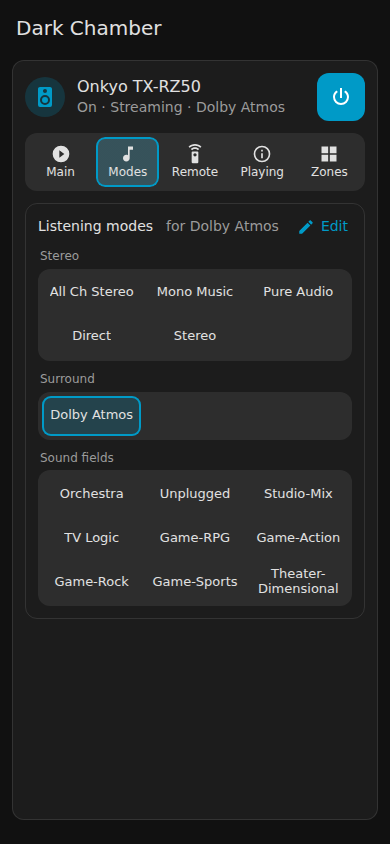
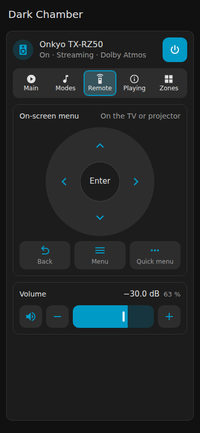
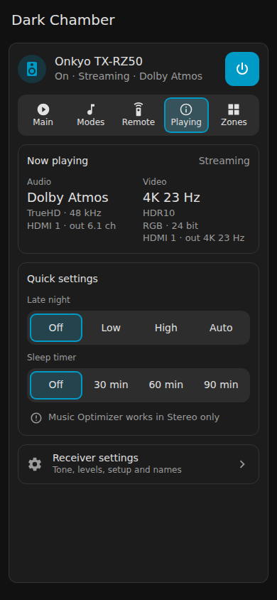
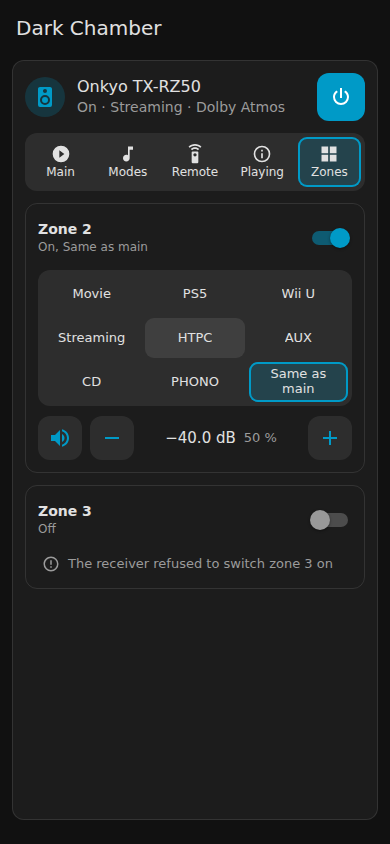
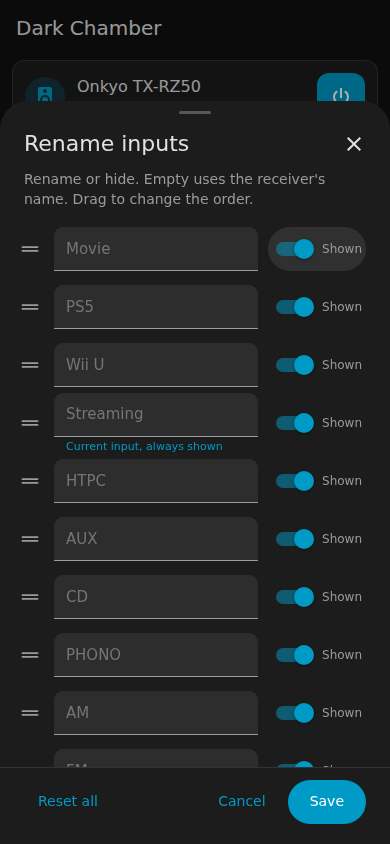
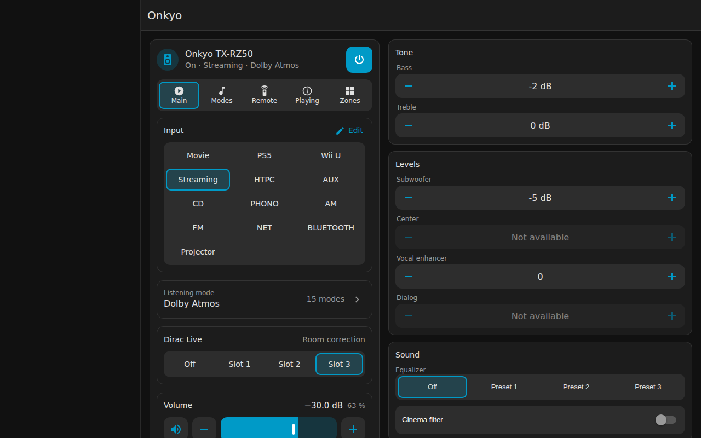
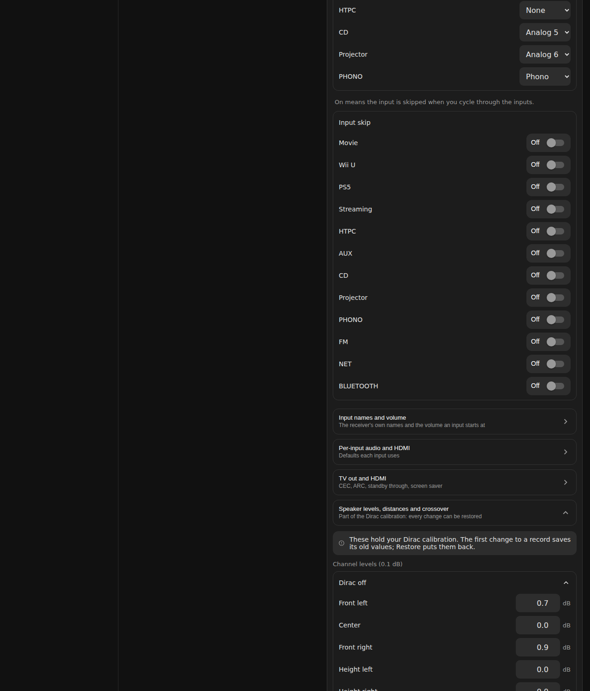

# Card and sidebar page

## The card

Edit a dashboard, add a card, and pick Onkyo Remote. Choose the receiver in the card editor. Tabs a model cannot use are hidden.

| Tab | What it holds |
|---|---|
| Main | Power, volume (tap the reading to switch between percent and dB), mute, input |
| Modes | Every listening mode the signal allows |
| Remote | Menu keys |
| Playing | Audio and video information, sound settings |
| Zones | Zone 2 and zone 3 power, volume and input |

## Names

Press Edit on the Input or Modes group. Rename an item, hide it, or drag inputs to change their order. An empty name goes back to the receiver's own name. Only administrators can change names.

## The sidebar page

The Onkyo entry in the sidebar shows the card full screen with the Names and Receiver tools.

### Advanced settings

This section replaces the receiver's removed Web Setup page. It groups input assign, names and volume, per-input audio and HDMI, TV out and HDMI, speaker levels, distances and crossovers, the equalizer, power and volume limits, zones, other options, and read-only information.

- Only administrators can change a value.
- Speaker levels, distances and crossovers are part of your Dirac calibration. The first change to a record saves its old values; Restore puts them back, and Keep forgets them. The saved values last until Home Assistant restarts or the integration reloads.
- Speaker layout and network are shown and never changed.
- A model that does not answer these settings shows no section. A receiver in standby may not answer; press Try again after switching it on.
