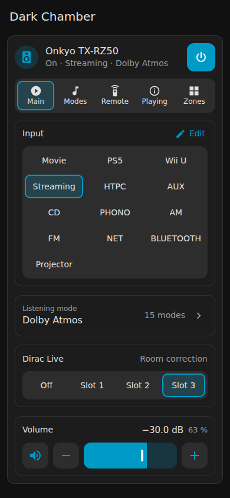

# Entities and actions

## Supported receivers

Built and checked on an Onkyo TX-RZ50. Other Onkyo, Pioneer and Integra network receivers speak the same eISCP protocol. The integration asks the receiver what it supports and shows only that, so other models are expected to work but are not tested. If something is missing or wrong on your model, run the `survey` action and open an issue (see [Troubleshooting](troubleshooting.md)).

## Entities

| Platform | What you get |
|---|---|
| Media player | Main zone, zone 2 and zone 3 (only the zones the receiver has): power, volume as a percent (dB as an attribute), mute, source, listening mode |
| Select | Dirac Live slot, late night, dimmer, equalizer, digital filter, HDMI output |
| Number | Bass, treble, subwoofer levels, centre level, vocal enhancement, dialog level, A/V sync, sleep timer |
| Switch | Music Optimizer, cinema filter |
| Sensor | Audio input, video input, temperature, front display (diagnostic, off by default) |
| Remote | On-screen menu keys through `remote.send_command` |

Entities that a model does not support are not created. A setting the receiver refuses in the current state (for example a listening mode the signal does not allow) shows as unavailable.

Inputs and listening modes use the receiver's own names, one entry each. You can rename, hide and order them.

## Remote card and sidebar page

The card has Main, Modes, Remote, Playing and Zones tabs. The sidebar page "Onkyo" opens the same card full screen, with the receiver settings. See [Card and sidebar page](card-and-sidebar.md).

## Actions

| Action | Use |
|---|---|
| `onkyo_eiscp.send_raw` | Send one eISCP message, such as `PWRQSTN`, and get the replies back. |
| `onkyo_eiscp.survey` | Ask the receiver for every known code (read only) and return a capture. Addresses and the MAC are removed. |

Both need `config_entry_id`. `send_raw` also needs `message`. Hidden inputs and modes stay available to `send_raw`.

## How data updates

The receiver pushes every change over one open connection, so nothing is polled. A keep-alive checks the connection, and when it drops the integration reconnects with growing pauses and logs one warning when the connection is lost and one line when it is back. All entities show unavailable while the connection is down.

## Diagnostics

Download diagnostics from the device page. The address and identifiers are hidden.
